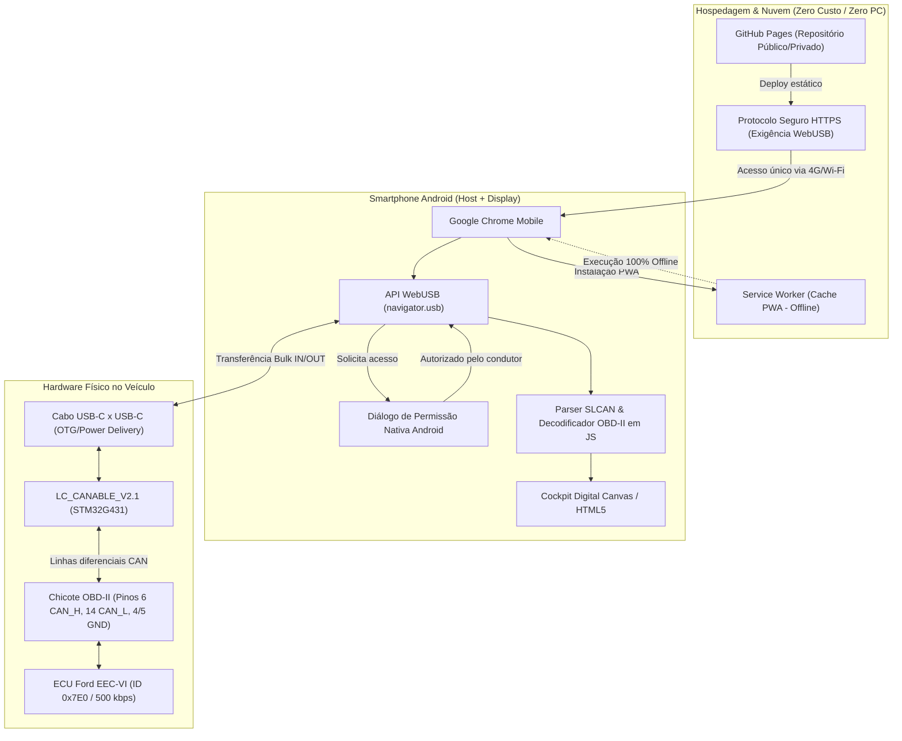

# Instruções de Integração: CANable no Celular via WebUSB & GitHub Pages

Este documento detalha o planejamento arquitetural, os fundamentos técnicos e o roteiro de testes para viabilizar a telemetria do **Ford Fiesta 2010 1.0 Zetec Rocam** diretamente no smartphone Android através de um cabo **USB-C para USB-C**, dispensando a necessidade de levar um computador para o veículo.

---

## 1. Visão do Projeto e Motivação

- **Cenário Atual:** O backend do cluster opera em Python (`FastAPI`, `pyserial`, `python-can`) rodando em PC/notebook ou TV Box, transmitindo dados via WebSockets para o navegador.
- **Demanda do Usuário (David):** Obter uma solução prática e portátil para testes imediatos no carro utilizando apenas o smartphone pessoal e a placa **LC_CANABLE_V2.1 (STM32G431)** com cabo USB-C macho x USB-C macho, sem a dependência contínua de um computador portátil no banco do passageiro.
- **Desafio Chave:** O Android não permite acesso direto a portas seriais (`/dev/ttyACM0`) sem permissões especiais de root, e aplicativos convencionais da Play Store (*Torque*, *Car Scanner*) operam com emulação ELM327, não reconhecendo os comandos em texto puro do padrão **SLCAN (Lawicel ASCII)** do CANable.
- **Solução Arquitetural:** Desenvolver uma aplicação Web client-side utilizando a **API WebUSB** nativa do Google Chrome no Android, hospedada no **GitHub Pages** (com HTTPS obrigatório) e equipada com recursos de **PWA (Progressive Web App)** para funcionamento 100% autônomo e offline.

---

## 2. Arquitetura da Solução WebUSB + GitHub Pages



---

## 3. O Papel do GitHub Pages e do Modo Offline (PWA)

### Por que hospedar no GitHub Pages?
1. **Requisito Mandatório do Navegador:** A especificação da W3C para as APIs `WebUSB` e `WebSerial` restringe a execução estritamente a **Contextos Seguros (Secure Contexts)**. Isso significa que páginas abertas localmente via `file:///` no celular têm o acesso USB bloqueado por segurança.
2. **Infraestrutura Pronta e Gratuita:** O GitHub Pages fornece hospedagem estática direta a partir do repositório Git com certificado SSL/TLS (HTTPS) nativo, sem exigir nenhum servidor backend intermediário ou custo operacional.
3. **Acesso Universal:** Qualquer dispositivo Android com Google Chrome pode carregar o painel digitando a URL pública (ex: `https://<usuario>.github.io/fiesta-cockpit`).

### Funcionamento Offline (PWA - Progressive Web App)
Em garagens subterrâneas, rodovias ou áreas sem sinal de operadora móvel (4G/5G), a página não pode depender da internet para carregar:
- **Service Worker (`sw.js`):** Intercepta as requisições de rede do navegador e armazena em cache todos os recursos estáticos (`index.html`, arquivos `.css`, scripts `.js`, ícones e fontes).
- **Instalação na Tela Inicial:** O navegador exibe a opção *"Adicionar à Tela de Início"*, criando um ícone idêntico ao de um aplicativo nativo.
- **Execução Sem Rede:** Uma vez carregado pela primeira vez, o painel abre instantaneamente mesmo em *Modo Avião*.

---

## 4. Protocolo de Comunicação: WebUSB para SLCAN

O microcontrolador **STM32G431** da placa CANable possui um descritor de dispositivo USB com as seguintes propriedades de referência:
- **Vendor ID (VID):** `0x1D50` (OpenMoko / Geschwister Schneider)
- **Product ID (PID):** `0x606F` (Geschwister Schneider CANable)
- **Classe USB:** CDC-ACM (Communications and CDC Control) ou Vendor-Specific (quando com firmware *candleLight*).

### Sequência de Inicialização no JavaScript:
1. **Filtro de Descoberta:**
   ```javascript
   const device = await navigator.usb.requestDevice({
     filters: [{ vendorId: 0x1d50, productId: 0x606f }]
   });
   ```
2. **Abertura e Configuração de Interface:**
   ```javascript
   await device.open();
   await device.selectConfiguration(1);
   await device.claimInterface(0); // Interface de dados
   ```
3. **Sequência de Inicialização do Barramento (SLCAN a 500 kbps):**
   - Enviar `C\r` (Fecha barramento para garantir estado limpo).
   - Enviar `S6\r` (Configura taxa para 500 kbps — padrão High-Speed CAN da Ford).
   - Enviar `O\r` (Abre o barramento CAN).
   - Enviar `V\r` (Verifica a versão do firmware CANable).
4. **Consulta de PIDs OBD-II (Direcionada à ECU Ford `0x7E0`):**
   - Consulta de RPM (PID `0x0C`): frame SLCAN `t7E0802010C00000000\r`
   - Consulta de Velocidade (PID `0x0D`): frame SLCAN `t7E0802010D00000000\r`
   - Leitura da resposta na fila Bulk IN (`t7E8...`) e decodificação pelas fórmulas estabelecidas no projeto.

---

## 5. Roteiro Prático: O que Fazer Quando o Cabo USB-C Chegar

Assim que o cabo USB-C para USB-C estiver em mãos, execute os passos em bancada antes de ir para o carro:

### Etapa 1: Inspeção Física e Conexão de Bancada
- [ ] Conecte uma ponta do cabo USB-C no conector da placa **LC_CANABLE_V2.1**.
- [ ] Conecte a outra ponta diretamente na entrada USB-C do smartphone Android.
- [ ] Observe o LED indicador da placa: o LED de alimentação (Power) deve acender imediatamente, comprovando que o smartphone está fornecendo alimentação de 5V (USB OTG / Power Delivery) para a placa.
- [ ] **Lembrete de Segurança:** O jumper de 120 $\Omega$ do CANable deve permanecer **desligado/aberto** para conexão veicular.

### Etapa 2: Teste de Reconhecimento no Navegador
- [ ] Abra o Google Chrome no celular.
- [ ] Acesse a página de teste disponibilizada no projeto (`Teste_WebUSB_CANable.html`).
- [ ] Toque no botão **"Solicitar Permissão USB"**.
- [ ] Verifique se o Android abre o pop-up nativo do sistema listando o dispositivo (ex: *"CANable V2.0 / Geschwister Schneider"*).
- [ ] Conceda a permissão.

### Etapa 3: Validação de Comandos SLCAN
- [ ] Na página de teste, toque no botão **"Conectar e Abrir Barramento (500k)"**.
- [ ] O console em tela deve registrar o envio de `O\r` e o retorno do caractere `\r` (CR) indicando aceitação pelo STM32.
- [ ] Toque no botão **"Consultar Versão ('V')"** e confirme a string de versão do firmware exibida no log.

---

## 6. Plano de Contingência (Análise de Risco Técnico)

Se o modelo específico do smartphone ou a versão do Android bloquear a captura da interface CDC (`SecurityError: Unable to claim interface`) devido à captura automática do driver pelo kernel do Android:

- **Plano B (APK Standalone via WebView):**  
  Empacotar o mesmo código HTML/JS dentro de um contêiner leve Android (usando Kotlin nativo ou *Capacitor/Cordova*) integrando a biblioteca consagrada [`usb-serial-for-android`](https://github.com/mik3y/usb-serial-for-android).  
  Essa biblioteca roda em espaço de usuário (*user space*), possui suporte homologado para o chip STM32/CDC do CANable e repassa o fluxo de bytes diretamente para a WebView do nosso Cockpit, garantindo 100% de funcionamento sem necessidade de *root*.

---

## 7. Rigor Metrológico Aplicado à Versão Mobile

Mesmo operando direto no navegador do celular, aplicam-se com total rigor as diretrizes de [AGENTS.md do Fiesta](file:///H:/Outros%20computadores/Meu%20computador/David-Pessoal/Projetos/Projeto%20Fiesta%20Zetec%20Rocam%201.0/AGENTS.md):
- PIDs lidos da ECU (`0x0C`, `0x0D`, `0x05`, `0x0B`, `0x11`) $\rightarrow$ Tag `REAL` (Verde).
- Marcha IB5 e Consumo Speed-Density calculados no JavaScript $\rightarrow$ Tag `ESTIMADO` (Âmbar).
- Tensão sem ADC físico $\rightarrow$ Tag `ESTIMADO` ("Aprox. por RPM • Sem ADC Físico").
